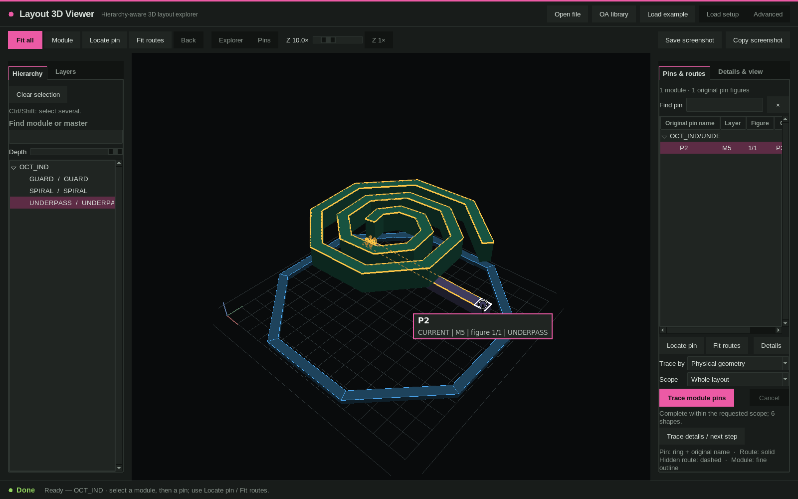

# Layout 3D Viewer (VL3D)

[中文说明](README.zh-CN.md)

Hierarchy-aware 3D viewer for IC layouts: open JSON, GDSII or OASIS files (and, optionally, Virtuoso OA libraries), pick a module and one of its pins, and follow the connected metal through vias in 3D. MIT licensed, runs locally.



## What it does

- Opens schema-v2 layout JSON (`.json` / `.json.gz`) and GDSII / OASIS stream files (gdstk first, KLayout as an optional fallback), with an optional layer-map / layer-profile file that you provide.
- Shows the layout as a rotatable 3D scene with a real perspective camera, a manual Z display scale and fast preview while dragging.
- Hierarchy explorer: search and highlight instances and masters, per-level pins, per-layer visibility and an Instances / Wires + vias switch.
- Pin tracing: **Physical geometry** follows touching conductors through declared via endpoints (no net names needed); **Named nets** follows hierarchy-scoped net names. Incomplete or truncated results are labelled as such.
- Pin labels keep the original name and show layer, figure number and instance path; *Locate pin*, *Fit routes*, *Module* and *Back* are separate view actions.
- Native Tk/OpenGL desktop client and a browser client (`public/`) that share the same colour palette; screenshots of the 3D view can be saved as PNG or copied to the clipboard (Linux: needs `wl-copy` or `xclip`).
- Optional OA workflow: choose an OA library and open a cell directly (needs your own Cadence environment, see below).

## Requirements

- Node.js 18 or newer (launcher and local backend) and Python 3.6 or newer with Tk.
- Native client Python packages (installed into a private virtual environment by `vl3d setup --native --install`): `numpy`, `ijson`, `gdstk`, `PyOpenGL`, `pyopengltk` (pinned in `requirements-native.txt`).
- An X11/OpenGL desktop session for the native client; a WebGL 2 browser for the browser client.
- **Optional**: Cadence Virtuoso with its license and your own PDK for OA libraries; KLayout for the stream fallback parser. None of these are needed for JSON / GDS / OASIS files or for the bundled example. Cadence, PDKs, licenses and real layouts are **not** distributed with this repository.

## Install / Quick start

```bash
git clone <this repository> layout-3d-viewer && cd layout-3d-viewer
./bin/vl3d doctor                       # diagnose Node, Python, Tk, display
./bin/vl3d setup --native --install     # private Python environment under $XDG_DATA_HOME/vl3d
./bin/vl3d gui --no-oa                  # no Cadence needed
```

In the window click **Load example**. It opens `examples/octagon-inductor.json`, a fully synthetic octagonal inductor (regenerate it with `python3 tools/make_example_inductor.py`). Select the `UNDERPASS` module, then pin `P2`: the trace follows the M5 underpass through the V5 via array into the M6 spiral (6 shapes).

`node_modules` is not part of the repository and is not needed to run the viewer. Developers who want the browser regression tests run `npm ci` (this installs only `playwright-core` from `package-lock.json`; no browser is downloaded). Layout files can be opened with **Open file** or any `.json`, `.gds`, `.oas` path in *Load setup*. More install details are in [docs/INSTALL.md](docs/INSTALL.md), usage in [docs/USAGE.md](docs/USAGE.md).

### Your own layer profile

A layout file carries layer names or GDS layer/datatype numbers, not their meaning. The repository ships only a name-based `profiles/generic.json` and a **fictional** `profiles/example-process.json`. For a real technology, supply your own profile or layer map (field *PDK profile JSON* / *Layer map JSON* in *Load setup*, or `VL3D_PDK_PROFILE`, `VL3D_PDK_PROFILE_DIR`, `VL3D_STREAM_LAYER_MAP`). Format and behaviour: [docs/LAYER_PROFILES.md](docs/LAYER_PROFILES.md).

## Using with Cadence

OA loading is optional and needs your own environment. Provide, in *Load setup* / *Advanced*, in the config file (`vl3d.config.example.json` shows every key), or via environment variables:

- the OA library or the project directory containing `cds.lib` (`VL3D_LIBRARY`, `VL3D_CDS_LIB`),
- a Cadence environment script that puts `virtuoso` on `PATH` (`VL3D_CADENCE_ENV`, `VL3D_VIRTUOSO`),
- your license setting (`CDS_LIC_FILE` / `LM_LICENSE_FILE`, passed through unchanged),
- your technology profile as described above.

OA libraries are opened read-only; results are cached under `$XDG_CACHE_HOME/vl3d`. The OA mode refuses to run as root. Start with OA disabled using `--no-oa`.

## CLI for agents

```bash
./bin/vl3d doctor [--json] [--library PATH] [--cds-lib FILE] [--cadence-env FILE] [--virtuoso FILE] [--python FILE]
./bin/vl3d setup [--write] [--native --install] [--library PATH]
./bin/vl3d gui [--no-oa] [--root PATH] [--config FILE]     # native client
./bin/vl3d web [--no-oa] [--host HOST] [--port PORT]        # browser client
python3 tools/import_stream_layout.py chip.gds --output chip.json --library STREAM --top TOP
python3 tools/make_example_inductor.py [output.json]
npm test                                                     # unit and integration tests (no EDA tools)
```

`doctor --json` prints machine-readable diagnostics with stable `VL3D-E####` error codes (see [docs/TROUBLESHOOTING.md](docs/TROUBLESHOOTING.md)). Configuration priority: command line, `VL3D_*` environment, user XDG config, project config, auto-detection.

## Limitations

- Not a DRC, LVS, parasitic-extraction or sign-off tool. Physical tracing uses confirmed via endpoints and real planar contact; ambiguous, truncated or cancelled results are reported as incomplete.
- Layer stacks without calibrated Z/thickness data are drawn as approximations and the interface says so. Display Z scaling never changes the data.
- GDSII / OASIS carry no net, terminal or pin semantics; unless you supply a pin-annotation file only geometry and hierarchy are available ([docs/PIN_ANNOTATION.md](docs/PIN_ANNOTATION.md)).
- Layout JSON must already be in micrometres ([docs/LAYOUT_JSON.md](docs/LAYOUT_JSON.md)).
- The screenshot buttons capture the 3D scene without the pin label overlay. Clipboard copy is Linux-only and needs `wl-copy` or `xclip`; otherwise use *Save screenshot*.
- The browser client is kept as a compatibility entry point; the native client is the primary interface.

## License

MIT, see [LICENSE](LICENSE). The bundled Three.js build keeps its own MIT notice ([NOTICE](NOTICE)).

## Related tools

Part of RF-FIELDWORK: Flux Studio, Cap Array Lab, VCO ISF Explorer, VCO Design Studio.
