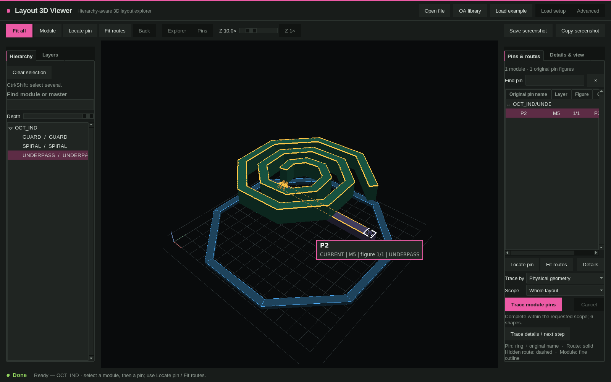

# Layout 3D Viewer（VL3D）

[English](README.md)

层级感知的 IC 版图三维查看器：打开 JSON、GDSII、OASIS（可选 Virtuoso OA 库），选择模块及其 pin，即可在三维中看到经过 via 连通的金属。MIT 许可，本地运行。



## 功能

- 打开 schema-v2 版图 JSON（`.json` / `.json.gz`）和 GDSII / OASIS 流文件（优先 gdstk，KLayout 为可选回退），可附带你自己提供的 layer map / layer profile。
- 可旋转的三维场景：真实透视相机、手动 Z 显示缩放，拖动时使用快速预览。
- 层级浏览：搜索并高亮 instance 与 master，各层级独立的 pin，按层显示开关，以及 Instances / Wires + vias 总开关。
- pin 追踪：**Physical geometry** 按几何接触并经已声明的 via 端点追踪（不需要 net 名）；**Named nets** 按层级作用域内的 net 名追踪。不完整或被截断的结果会明确标注。
- pin 标签保留原名，并显示层、figure 编号和实例路径；*Locate pin*、*Fit routes*、*Module*、*Back* 是互相独立的视角操作。
- 原生 Tk/OpenGL 桌面客户端和浏览器客户端（`public/`）使用同一组配色；三维视图截图可保存为 PNG 或复制到剪贴板（Linux 需要 `wl-copy` 或 `xclip`）。
- 可选的 OA 流程：选择 OA 库并直接打开 cell（需要你自己的 Cadence 环境，见下）。

## 环境要求

- Node.js 18 及以上（启动器与本地后端），Python 3.6 及以上并带 Tk。
- 原生客户端的 Python 包（由 `vl3d setup --native --install` 装入私有虚拟环境）：`numpy`、`ijson`、`gdstk`、`PyOpenGL`、`pyopengltk`（版本固定在 `requirements-native.txt`）。
- 原生客户端需要 X11/OpenGL 桌面会话；浏览器客户端需要支持 WebGL 2 的浏览器。
- **可选**：用于 OA 库的 Cadence Virtuoso 及其 license 和你自己的 PDK；用于流文件回退解析的 KLayout。打开 JSON / GDS / OASIS 或内置示例都不需要这些。本仓库**不**包含 Cadence、PDK、license 或真实版图。

## 安装与快速开始

```bash
git clone <本仓库地址> layout-3d-viewer && cd layout-3d-viewer
./bin/vl3d doctor                       # 诊断 Node、Python、Tk、显示
./bin/vl3d setup --native --install     # 在 $XDG_DATA_HOME/vl3d 下创建私有 Python 环境
./bin/vl3d gui --no-oa                  # 不需要 Cadence
```

在窗口中点击 **Load example**，会打开 `examples/octagon-inductor.json`（完全合成的八边形电感，可用 `python3 tools/make_example_inductor.py` 重新生成）。选中 `UNDERPASS` 模块再选 pin `P2`，追踪会沿 M5 下穿线经 V5 过孔阵列进入 M6 螺旋（共 6 个图形）。

仓库不包含 `node_modules`，运行查看器也不需要它。需要跑浏览器回归测试的开发者执行 `npm ci`（只按 `package-lock.json` 安装 `playwright-core`，不会下载浏览器）。可用 **Open file**，或在 *Load setup* 中填写 `.json`、`.gds`、`.oas` 路径来打开自己的版图。更多安装说明见 [docs/INSTALL.md](docs/INSTALL.md)，使用说明见 [docs/USAGE.md](docs/USAGE.md)。

### 自带 layer profile

版图文件只有层名或 GDS 的 layer/datatype 编号，不含其含义。仓库只附带按名称推断的 `profiles/generic.json` 和**虚构**的 `profiles/example-process.json`。真实工艺请自备 profile 或 layer map（*Load setup* 中的 *PDK profile JSON* / *Layer map JSON*，或环境变量 `VL3D_PDK_PROFILE`、`VL3D_PDK_PROFILE_DIR`、`VL3D_STREAM_LAYER_MAP`）。格式与行为见 [docs/LAYER_PROFILES.md](docs/LAYER_PROFILES.md)（英文）。

## 配合 Cadence 使用

OA 加载是可选功能，需要你自己的环境。可在 *Load setup* / *Advanced*、配置文件（`vl3d.config.example.json` 列出全部键）或环境变量中提供：

- OA 库，或包含 `cds.lib` 的工程目录（`VL3D_LIBRARY`、`VL3D_CDS_LIB`）；
- 能让 `virtuoso` 进入 `PATH` 的 Cadence 环境脚本（`VL3D_CADENCE_ENV`、`VL3D_VIRTUOSO`）；
- 你的 license 设置（`CDS_LIC_FILE` / `LM_LICENSE_FILE`，原样透传）；
- 如上所述的你自己的工艺 profile。

OA 库只读打开，结果缓存在 `$XDG_CACHE_HOME/vl3d`。OA 模式拒绝以 root 运行。可用 `--no-oa` 关闭 OA 启动。

## 命令行（供 agent 使用）

```bash
./bin/vl3d doctor [--json] [--library PATH] [--cds-lib FILE] [--cadence-env FILE] [--virtuoso FILE] [--python FILE]
./bin/vl3d setup [--write] [--native --install] [--library PATH]
./bin/vl3d gui [--no-oa] [--root PATH] [--config FILE]     # 原生客户端
./bin/vl3d web [--no-oa] [--host HOST] [--port PORT]        # 浏览器客户端
python3 tools/import_stream_layout.py chip.gds --output chip.json --library STREAM --top TOP
python3 tools/make_example_inductor.py [output.json]
npm test                                                     # 单元与集成测试（不需要 EDA 工具）
```

`doctor --json` 输出带稳定 `VL3D-E####` 错误码的机器可读诊断（见 [docs/TROUBLESHOOTING.md](docs/TROUBLESHOOTING.md)）。配置优先级：命令行、`VL3D_*` 环境变量、用户 XDG 配置、项目配置、自动检测。

## 限制

- 不是 DRC、LVS、寄生提取或签核工具。物理追踪只使用已确认的 via 端点和真实的平面接触；有歧义、被截断或被取消的结果会标注为不完整。
- 没有校准 Z/厚度数据的层叠按近似绘制，界面会明确提示；显示 Z 缩放不会改变数据。
- GDSII / OASIS 不含 net、terminal、pin 语义；除非提供 pin 注解文件，否则只有几何和层次（见 [docs/PIN_ANNOTATION.md](docs/PIN_ANNOTATION.md)）。
- 版图 JSON 必须已经是微米单位（见 [docs/LAYOUT_JSON.md](docs/LAYOUT_JSON.md)）。
- 截图按钮截取的是不含 pin 标签覆盖层的三维场景。复制到剪贴板仅限 Linux，需要 `wl-copy` 或 `xclip`，否则请用 *Save screenshot*。
- 浏览器客户端保留为兼容入口，原生客户端是主界面。

## RF-FIELDWORK

产品介绍页：https://rf-fieldwork.pages.dev/layout/?lang=zh（含配音演示片的工具在页面上可直接观看）

其他开源工具：

- [Flux Studio](https://github.com/chloeyntu-byte/flux-studio)：参数化射频无源器件、EMX 扫参、多目标优化与 SNPFit 拟合
- [Cap Array Lab](https://github.com/chloeyntu-byte/cap-array-lab)：电容阵列 C/Q、寄生路径、谐振与 Z11
- [VCO ISF Explorer](https://github.com/chloeyntu-byte/vco-isf-explorer)：ISF、闪烁噪声上变频与相噪贡献

## 许可

MIT，见 [LICENSE](LICENSE)。内置的 Three.js 保留其自身的 MIT 声明（[NOTICE](NOTICE)）。

